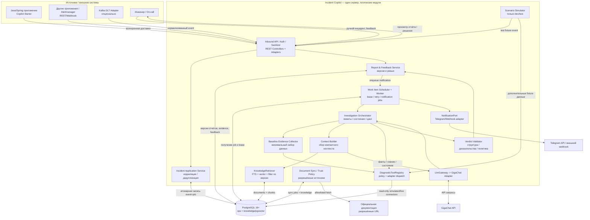
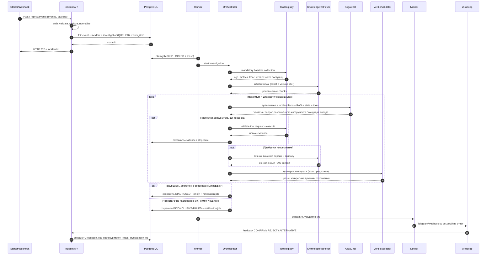
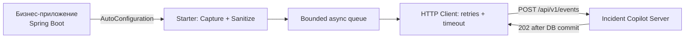
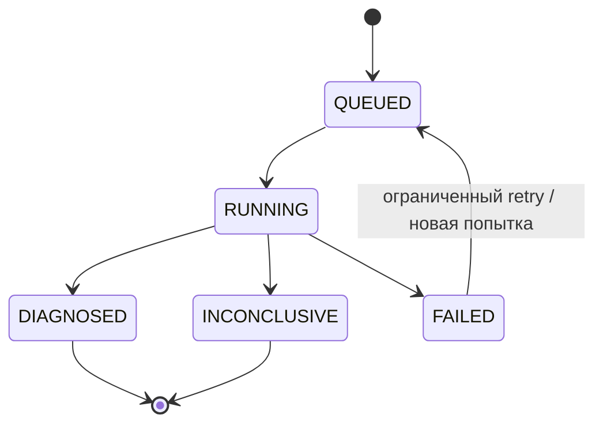
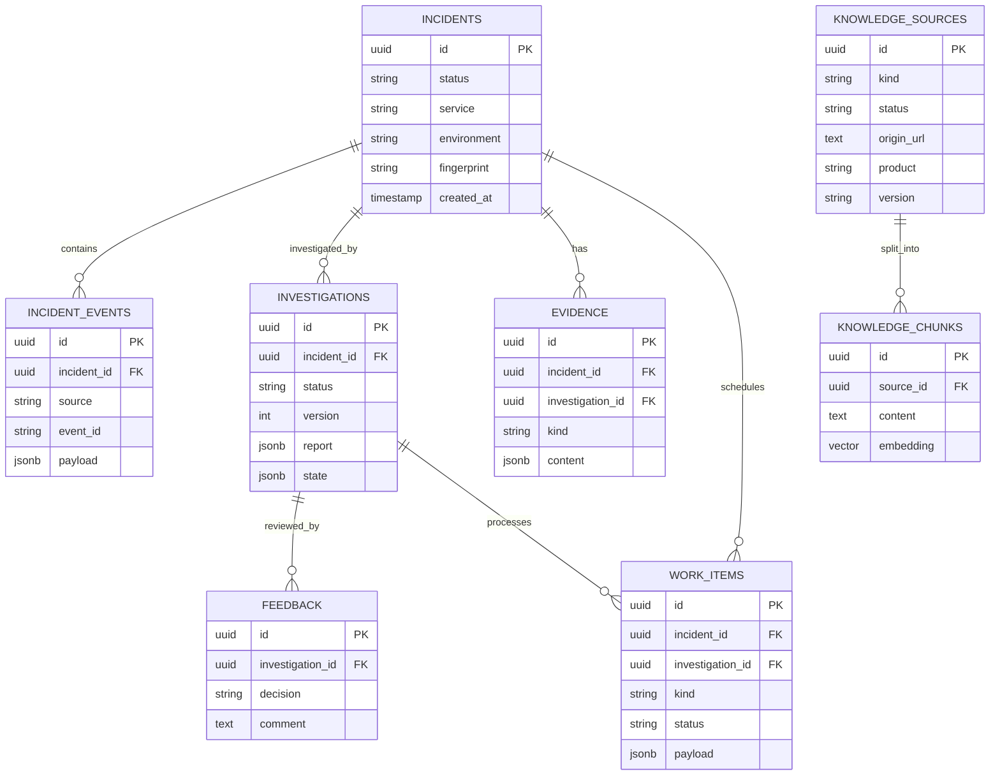
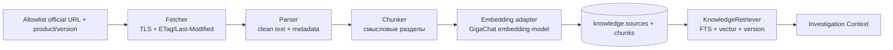
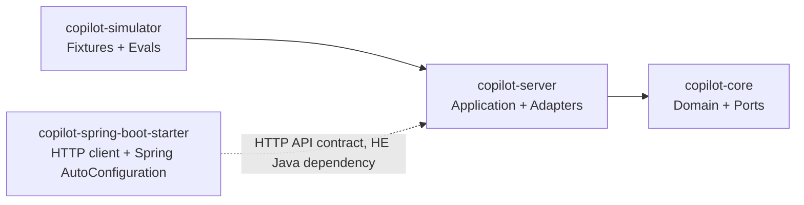

# Incident Copilot

> **Статус:** Architecture & Product Specification v1.0 · **Дата:** 13.10.2026 · **Язык документации:** русский  
> **Назначение документа:** единый исходный документ для SDD (Spec-Driven Development) с Claude Code.  
> **Состояние реализации:** архитектура и требования **спроектированы**, продукт ещё **не реализован и не протестирован**. Примеры API и UI ниже — **контракты будущей системы**, не заявления о готовых функциях.

---

## 0. Кратко о продукте

**Incident Copilot** — подключаемая платформа интеллектуального расследования технических инцидентов. Она автоматически или по запросу инженера принимает событие, собирает диагностические факты, сопоставляет их с релевантной документацией и подтверждённым опытом, проверяет гипотезы при помощи инструментов и возвращает **один наиболее обоснованный вердикт с рекомендациями по исправлению**. Результат поступает инженеру в веб-интерфейс и, при настроенном канале, в Telegram.

**Основная ценность:** сократить ручное переключение между логами, метриками, документацией и историей аварий. Пользователь получает не пересказ stack trace, а проверяемую причинную гипотезу, последствия и конкретный план действий.

**Основные свойства:**

- **Универсальность:** общий контракт события для HTTP 500, исключений Java, PostgreSQL, JVM, внешних API, Kafka DLT, мониторинговых алертов; Kafka не является обязательной частью системы.
- **Встраиваемость:** лёгкий Spring Boot Starter для Java/Spring; REST/Webhook для любых других технологий. AI-движок **не встраивается** в рабочее приложение.
- **Автоматизм:** в штатном режиме расследование стартует после поступления события **асинхронно**; ручной запуск доступен через API/UI.
- **Evidence-driven:** реальные сведения от инструментов важнее «знаний» языковой модели; документы подтверждают технический механизм, а не то, что именно он произошёл.
- **Human-in-the-loop:** инженер может подтвердить/отклонить гипотезу, запросить следующую, добавить факты, указать фактическую причину и закрыть инцидент.
- **Контролируемая память:** ответы LLM **не добавляются автоматически** в доверенную базу знаний. Исторический кейс допускается в поиск только после независимой проверки и одобрения.
- **Отказоустойчивость:** отсутствие GigaChat не нарушает работу подключённого приложения и не уничтожает принятое событие.

### 0.1. Целевая аудитория и сценарии

| Пользователь | Боль | Что получает |
|---|---|---|
| Backend-разработчик | Ошибка незнакомого сервиса, непонятный stack trace | Контекстную диагностику, вероятную причину и следующие проверки |
| On-call / SRE / служба поддержки | Много разрозненных алертов и систем | Единый инцидент, уведомление, результат AI-расследования |
| Команда сопровождения | Утрата знаний после решения аварий | Проверенные runbooks и повторно используемый опыт |
| Автор небольшого Spring Boot-сервиса | Нет полноценного мониторингового стека | Возможность отправить ошибку в API и получить разбор |

**Продуктовая гипотеза, которую нужно проверить:** система сокращает ручные шаги первичной диагностики и повышает долю полезных первых рекомендаций. Это не подтверждённый рыночный результат; измеряем на симуляторе и позднее — на реальных сценариях.

### 0.2. Важные границы

- Copilot **не гарантирует** выявление первопричины любого инцидента: иногда телеметрия объективно отсутствует.
- Успешный отчёт `DIAGNOSED` не содержит раздел «чего не хватает»; если обоснованный вывод невозможен — `INCONCLUSIVE` и отдельное краткое служебное уведомление без выдуманного диагноза.
- Пользователю показывается **одна основная гипотеза**. Внутренние альтернативы сохраняются для процесса и не выводятся в основном отчёте.
- В пользовательском отчёте **нет ссылок на документацию и на сырые доказательства**. Внутри системы сохраняются `evidenceId`, `sourceId`, версии и результаты проверок для аудита и тестов.
- Автоматические действия в production, произвольные SQL/shell-команды и изменения инфраструктуры **не входят в MVP**.
- Учебный MVP работает на **симулированных** фактах; не должен создавать видимость анализа настоящего производства.

---

## 1. Архитектурные решения (зафиксированы)

| Решение | Выбор | Почему |
|---|---|---|
| Архитектура | **Модульный монолит + ports/adapters (Clean/Hexagonal)** | Изолировать ответственность без набора микросервисов |
| Java | **Java 21**, Spring Boot 3.5.x | Практический Java/Spring-стек; точные версии закрепить после smoke-теста |
| AI-фреймворк | **Spring AI 1.1.x совместимой стабильной версии** | Управление AI-клиентом, RAG и tools; не смешивать примеры от Spring AI 2.x / Boot 4 |
| Модель | **GigaChat** | Практика API без обязательного зарубежного VPN; доступность и ограничения проверить на аккаунте |
| AI-провайдер | `LlmGateway` + `GigaChatAdapter` | Не связывать Domain и Application со специфичным SDK |
| Структура | **Один PostgreSQL 16+**, расширение **pgvector** | Операционные данные, очередь и документы в одной транзакционной СУБД |
| Логическое разделение | Схемы **`ops`** и **`knowledge`** | **Не две базы данных**, а две области ответственности |
| Очередь | `ops.work_items`, `FOR UPDATE SKIP LOCKED`, lease/retry | Сохранность задания после коммита без Kafka/RabbitMQ в MVP |
| Поиск | Сначала exact/FTS, затем vector search, фильтрация по версии | Точные коды и имена исключений нельзя терять при семантическом поиске |
| MCP | Тот же `DiagnosticToolPort`, MCP adapter для выбранных read-only tools | Никакой параллельной реализации бизнес-логики tools |
| Вывод | **Spring MVC + Thymeleaf** (MVP UI), REST + NotificationPort (Telegram, webhook) | Веб-панель в том же сервере без отдельного frontend-сервиса |
| Встраивание | Starter только для **сбора и доставки событий** | При ошибке Copilot бизнес-приложение продолжает работу |
| Данные симулятора | Fixtures + отдельные эталонные ответы вне контекста агента | Честные AI-evaluations, отсутствие утечки ground truth |

**Важное технологическое условие:** конкретная версия/тариф GigaChat может не поддерживать все функции одинаково. `tool calling`, embeddings, строгий structured output и TLS проверяются отдельными spike-тестами. Если `response_format=json_schema` недоступен, использовать JSON-подобный вывод + Jackson/JSON Schema validation + ограниченный retry. Запрещено обходить TLS-проверку через `verify_ssl=false` в production-конфигурации.

### 1.1. Что сознательно не добавляем

Нет отдельного брокера сообщений, Redis, Elasticsearch, Kubernetes, микросервиса «RAG», микросервиса «notifications», отдельной базы для embeddings, автономного remediation-agent и собственного ML-классификатора. При появлении измеренной необходимости их можно обсудить через ADR.

---

## 2. Полная архитектура компонентов

### 2.1. Общая схема контейнера и внутренних компонентов (C4-подобная)



**Правило схемы:** прямой доступ к таблицам и клиентам внешних систем имеют инфраструктурные адаптеры/репозитории, а не Domain. Стрелки на логической схеме показывают зависимости и поток данных, не означают, что `Domain` вызывает SQL сам.

### 2.2. Последовательность одного автоматического расследования



### 2.3. Архитектурные слои (Clean Architecture)

| Слой/модуль | Основные компоненты | Единственная ответственность | Может зависеть от |
|---|---|---|---|
| **Domain** | `Incident`, `IncidentEvent`, `Evidence`, `Investigation`, `Verdict`, `Feedback`, правила состояний | Предметные сущности и инварианты | Только Java/Domain |
| **Application — Incident** | `AcceptEventUseCase`, `IncidentService`, `CorrelationPolicy` | Приём, дедупликация, группировка, статус инцидента | Domain + порты |
| **Application — Investigation** | `InvestigationOrchestrator`, `BaselineEvidenceCollector`, `InvestigationContextBuilder`, `VerdictValidator` | Управление расследованием, шагами, проверками и итогом | Domain + порты |
| **Application — Knowledge** | `KnowledgeRetrievalUseCase`, `KnowledgePromotionPolicy` | Правила доверия, версии и выбора знаний | Domain + порты |
| **Application — Notification** | `NotifyEngineerUseCase` | Решение «кому/когда/что отправить» | Domain + `NotificationPort` |
| **Ports** | `IncidentRepository`, `WorkQueuePort`, `EvidenceSourcePort`, `LlmGateway`, `KnowledgeRetrieverPort`, `NotificationPort`, `DiagnosticToolPort` | Независимые контракты внешнего мира | Domain |
| **Inbound adapters** | REST Controllers, Webhook adapter, Simulator, будущий MCP facade | Преобразуют вход в use cases | Application |
| **Outbound adapters** | PostgreSQL repositories, GigaChat adapter, pgvector, simulated tools, Telegram, documentation fetcher | Реализуют порты, HTTP/SQL/SDK | Ports / инфраструктура |
| **Delivery libraries** | `copilot-spring-boot-starter` | Локальный захват событий и доставка в сервер | Spring / HTTP, но **не** на `copilot-server` |

Инъекции зависимостей настраиваются в composition root Spring. **Запрещено:** `Domain -> Spring AI`, `Domain -> JPA`, `Application -> конкретный GigaChat SDK`, `Starter -> backend database`, `LLM -> произвольный SQL/shell`.

### 2.4. Функции и связи компонентов

| Компонент | Вход | Выход | Не делает |
|---|---|---|---|
| `EventController` | JSON + auth | `AcceptEventCommand` | Не диагностирует |
| `EventSanitizer` | Сырые/нормализованные поля | Безопасный `IncidentEvent` | Не сообщает LLM секреты |
| `IncidentService` | Valid event | `incidentId`, relation event→incident | Не вызывает GigaChat |
| `CorrelationPolicy` | fingerprint/service/time | Решение new/attach | Не решает причину инцидента |
| `WorkItemWorker` | persisted job | запуск use case / retry / notification | Не содержит prompt-логику |
| `BaselineEvidenceCollector` | incident + capabilities | snapshot минимальных фактов | Не придумывает отсутствующие метрики |
| `DiagnosticToolRegistry` | разрешённый tool call | типизированный факт/ошибка | Не позволяет shell/raw SQL |
| `KnowledgeRetriever` | query + tech version | кандидаты chunks с source metadata | Не определяет root cause |
| `InvestigationContextBuilder` | facts + chunks + state | ограниченный по токенам контекст | Не хранит «память» внутри LLM |
| `LlmGateway` | prompt + tools | structured `AiDecision` | Не сохраняет инциденты |
| `InvestigationOrchestrator` | investigation job | обновлённый state, verdict или failure | Не обращается напрямую к JPA/GigaChat SDK |
| `VerdictValidator` | candidate + evidence + docs | `PASS / REJECT(reason)` | Не доказывает причинность математически |
| `ReportService` | принятый verdict | неизменяемая версия отчёта | Не отправляет Telegram сам |
| `FeedbackService` | инженерное решение | feedback + optional next job | Не превращает комментарий в доверенный RAG автоматически |
| `KnowledgeSync` | allowlisted source config | новые/обновлённые chunks | Не переписывает знания по ответу LLM |
| `NotificationAdapter` | job + адресат | delivery result | Не формирует диагноз |

---

## 3. Как именно работает AI-диагностика

### 3.1. Не «один умный промпт», а управляемый процесс

**Java-приложение заранее определяет:** обязательный набор источников, полномочия и схемы tools, лимит шагов, время и бюджет, формат ответа, критерии проверки и состояние расследования. **GigaChat делает:** предлагает гипотезы на основе полученных фактов, решает, что уточнить в пределах доступных tools, интерпретирует ответы, предлагает вердикт и рекомендации.

**Контекст для каждого вызова LLM формируется заново логически** (API может поддерживать передачу истории сообщений, но источник правды — наш PostgreSQL):

1. **System context:** роль, политика «факт/гипотеза», требования к доказательствам, разрешённые действия, схема `AiDecision`.
2. **Incident context:** тип события, сервис, среда, время, stack trace, отобранные логи/метрики/traces, версии.
3. **Knowledge context:** только релевантные snippets из docs/runbooks/verified cases с внутренними `sourceId`, версиями и признаком доверия.
4. **Investigation state:** уже проверенные/опровергнутые версии, tool results, инженерный feedback, бюджет попыток.
5. **Tools specifications:** наименование, аргументы, описание и права, а не произвольный доступ к окружению.

Не передавать всю БД в модель; ограничивать размер, ранжировать и делать summary **без потери фактических чисел и ссылочных ID**. Документы и tool responses — **недоверенный вход**, а не инструкции системы.

### 3.2. Минимальный baseline для любого инцидента

До первого вызова LLM запускаем сбор общего набора **по доступности**:

| Категория | Параметры | Когда доступна |
|---|---|---|
| Event metadata | source, type, severity, firstSeen, service, environment | всегда из входного события (поля могут быть неизвестны) |
| Failure | exception class/message, stack trace, error code, HTTP status | при наличии у источника |
| Correlation | traceId/requestId, соседние события ± configurable window | при наличии ID/связанного потока |
| Runtime | language/runtime/framework/library versions | при наличии `environment` / starter metadata |
| Observability | логов, метрик, трассировок за окно вокруг события | при подключённом адаптере/симуляторе |
| Change context | недавний деплой/конфигурация | при подключённом адаптере/симуляторе |

Baseline не должен принуждать каждое приложение ставить Prometheus/ELK/Kafka. Для ручного инцидента с одной ошибкой состоится ограниченное расследование без фиктивных данных.

### 3.3. RAG и момент его вызова

Сначала `KnowledgeRetriever` выполняет **первичный поиск** по exception/error code и метаданным технологий, затем выдаёт 3–8 пригодных snippets, ориентировочно (параметр конфигурации, проверяется экспериментально). LLM получает их **до построения первого набора гипотез**. На следующих шагах модель вправе запросить дополнительный `search_knowledge`, если требуются сведения о конкретном механизме, но повторять прежний поиск бессмысленно.

**Документация не подтверждает, что конкретная ошибка произошла в нашем сервисе.** Она подтверждает возможность механизма, применимость к версии, типичные условия и диагностические проверки. Конкретная причина обосновывается телеметрией, фактами и, при необходимости, результатом воспроизведения/исправления.

### 3.4. Итерационный процесс

Параметры на старте: `maxDecisionCycles=10`, отдельные лимиты `maxTotalToolCalls`, `maxDurationSeconds`, `maxInputTokens`, `maxOutputTokens`, `maxRetrievals`. Точные значения после eval-тестов. **10 — потолок, а не число обязательных циклов.** Одна итерация = запрос LLM → решение → разрешённые tool calls или candidate verdict → проверка → обновление persisted state.

```text
ACCEPT EVENT (transaction: event + incident + durable work_item)
  -> CLAIM JOB
  -> BUILD BASELINE (deterministic tools)
  -> RETRIEVE INITIAL DOCUMENTS (exact/FTS/vector/version)
  -> LOAD INVESTIGATION STATE
  -> for cycle in 1..maxDecisionCycles:
       context = build(system, incident, new_evidence, knowledge, history, budgets)
       decision = llm.analyze(context, allowedToolSchemas)
       if decision requests tools:
           validate names/arguments/permissions, execute bounded calls
           store results as Evidence; update state; continue
       if decision requests knowledge:
           retrieve matching versioned docs; update state; continue
       if decision proposes verdict:
           validate structure, fact IDs, technical mechanism, contradictions,
                    remediation safety, cause-vs-symptom distinction
           if passed and evidence sufficient: persist DIAGNOSED + report + notify job; stop
           else: add validator issues to state; continue
  -> if not diagnosed: persist INCONCLUSIVE or FAILED + notify job
```

Если модель «не знает», она должна выбрать следующий **полезный** тест, а не бессмысленно перебирать гипотезы. Повтор идентичного вызова с неизменившимися входами блокируется или берётся из кеша результатов данной investigation.

### 3.5. Критерии проверки кандидата (gates)

| Gate | Что проверяем | Автоматизация |
|---|---|---|
| `SCHEMA` | Корректный JSON/DTO, обязательные поля | детерминированно |
| `EVIDENCE` | Утверждения о фактах связаны с реально полученными `evidenceId` | детерминированно + семантическая оценка |
| `MECHANISM` | Механизм технически возможен для указанной версии и не противоречит найденным документам | version filters + документация + LLM-оценка, не абсолютная гарантия |
| `CAUSALITY` | Объяснение связывает причину и симптомы, различает следствие и источник | эвристики + LLM-оценка; иногда только эксперт/эксперимент подтвердит |
| `RESOLUTION` | Советы применимы, безопасны и не требуют недопустимых действий | policy checks + экспертные шаблоны |
| `COMPLETENESS` | Для успешного ответа достаточно фактов, а не просто правдоподобной догадки | правила и настраиваемые пороги; возможность `INCONCLUSIVE` |

Нельзя считать, что все gates дают математическое доказательство. Даже `DIAGNOSED` содержит **«основную гипотезу»**, а не автоматически подтверждённую root cause. Флаг `engineerConfirmed` / `resolutionVerified` отдельный.

### 3.6. AI Decision — внутренний контракт

```json
{
  "decisionType": "REQUEST_TOOLS",
  "workingHypothesis": "Соединения БД удерживаются слишком долго",
  "supportingEvidenceIds": ["ev-1", "ev-3"],
  "nextToolCalls": [
    {"name": "get_database_activity", "args": {"service": "order-service"}}
  ],
  "reason": "Необходимо отличить медленный SQL от долгоживущих транзакций"
}
```

Допустимые типы: `REQUEST_TOOLS`, `REQUEST_KNOWLEDGE`, `PROPOSE_VERDICT`. Внутренние гипотезы могут быть множественными, но финальный интерфейс отображает одну основную. Не показываем приватное цепочечное рассуждение модели; фиксируем **краткое инженерное обоснование и следы вызовов**.

### 3.7. Пример — три итерации, не Kafka

**Сценарий:** после деплоя `order-service` стали расти HTTP 500 и ожидание HikariCP.

1. Baseline: `Hikari active=20/20`, `pending=18`, ошибка `SQLTransientConnectionException`; RAG нашёл релевантную документацию HikariCP и Spring Transactions.
2. LLM предполагает исчерпание пула как симптом и просит `get_database_activity`. Tool даёт `idle in transaction = 14`, длительность ряда транзакций ~180 c.
3. LLM просит `get_trace`: у ряда запросов внешний HTTP-вызов происходит в границах удержания транзакционного соединения; гипотеза длительного удержания объясняет симптом. Validator требует связать вывод с ID всех полученных свидетельств, проверить механизм по версии документации. Если проверка достаточна — отчёт с основной гипотезой и рекомендациями, иначе новая итерация/`INCONCLUSIVE`.

Пример **не гарантирует**, что всякий `idle in transaction` вызван сетевым вызовом: такого вывода нельзя делать без связанных трассировок и границ транзакции.

### 3.8. Пользовательский отчёт (без альтернатив и ссылок)

```json
{
  "incidentId": "b164202f-7a7f-4c78-b638-7519d9c1f345",
  "investigationId": "9cc1a58a-6f48-4c7e-9d4d-e6b987aec8a4",
  "status": "DIAGNOSED",
  "reportVersion": 1,
  "category": "DATABASE_POOL_EXHAUSTED",
  "description": "Часть запросов order-service завершается HTTP 500 при получении соединения",
  "confirmedFacts": [
    "Заняты все 20 соединений пула HikariCP",
    "18 запросов ожидают соединения",
    "Найдены длительные транзакции"
  ],
  "primaryHypothesis": "Вероятное длительное удержание соединений транзакциями во время внешних сетевых вызовов",
  "potentialImpact": [
    "Рост времени ответа API",
    "Увеличение доли ошибок HTTP 500"
  ],
  "recommendedActions": [
    "Проверить границы @Transactional для затронутого пути",
    "При допустимости по бизнес-инвариантам вынести сетевые ожидания за границы транзакции",
    "После исправления проверить время удержания соединения и число pending запросов"
  ],
  "engineerConfirmed": false
}
```

**Внешний отчёт намеренно не содержит:** альтернативные гипотезы, URL источников, сырые Evidence IDs, раздел недостающих данных. **Внутренний persisted verdict** хранит ссылки и трассировку проверок. Для `INCONCLUSIVE` отчёт этого формата не генерируется.

---

## 4. Интеграция и встраиваемый Spring Boot Starter

### 4.0. UI и уведомления без нового микросервиса

**Веб-панель** входит в `copilot-server`: Spring MVC + Thymeleaf, адаптивный минималистичный UI без отдельного frontend-приложения. Экран списка инцидентов отображает service/severity/status/время, карточка — последний успешный отчёт, текущий статус расследования и действия `CONFIRM`, `REJECT`, `ALTERNATIVE`, `ADD_EVIDENCE`, `RESOLVE`. Переходы между состояниями выполняются через те же application use cases, что и REST; шаблоны не содержат бизнес-логики. В MVP допустим периодический polling `GET /incidents/{id}`; SSE и WebSocket не обязательны.

**Telegram** — только исходящие уведомления (короткий текст и ссылка на защищённый UI). Никакие пароли, токены, трассировки и сырые логи в Telegram не отправлять. **Встроенной системы пользователей/команд в MVP нет**: пользователи входят через Spring Security с внешне настраиваемой аутентификацией, а соответствие `service → notification channel` берётся из конфигурации. Для локальной демонстрации допускаются test credentials под отдельным `dev` profile; в production доступ должен быть защищён полноценной аутентификацией (например, OIDC/JWT) и ролями.

### 4.1. Принцип подключения



Starter должен иметь **автоконфигурацию через стандартный механизм Spring Boot**, быть opt-in и конфигурироваться. Он не вмешивается в нормальную обработку запросов и не подменяет существующие `@ControllerAdvice` бизнес-приложения. Захват исключений реализуется проверенными нехрупкими адаптерами и программным `IncidentReporter`.

**Техническая честность:** асинхронная in-memory очередь starter с небольшими retry гарантирует **best-effort**, а не абсолютную доставку при аварийном завершении процесса. Для строгой гарантии доставки потребуется локальный transactional outbox клиентского приложения — отдельная опциональная интеграция P1.

### 4.2. Конфигурация (желаемый контракт)

```yaml
incident-copilot:
  enabled: true
  endpoint: https://incident.example.internal
  service-name: order-service
  environment: staging
  api-key: ${INCIDENT_COPILOT_API_KEY}
  capture:
    unhandled-exceptions: true
    http-5xx: true
    stacktrace: true
    request-body: false
  transport:
    async: true
    queue-capacity: 1000
    connect-timeout: 1s
    read-timeout: 2s
    max-retries: 3
```

`api-key` хранится в секретах окружения, не коммитится. Данные запросов/ответов и Authorization headers не собираются по умолчанию. При переполнении очереди — настройка `DROP_WITH_METRIC`/тестируемая альтернатива, но **не** блокировать request thread по умолчанию.

### 4.3. REST/Webhook — альтернатива starter

Внешняя система отправляет тот же нормализованный контракт; адаптер конкретного источника отвечает только за преобразование формата. DLT-событие может прийти через REST из внешнего DLT consumer/adapter; центральный Copilot **не должен** становиться Kafka consumer по умолчанию.

### 4.4. Kafka DLT как опциональный источник

Типичные причины попадания сообщения в DLT в зависимости от настройки Kafka/Spring Kafka: ошибки десериализации, конвертации, валидации, бизнес-инвариантов, БД, timeout внешней зависимости и неожиданные исключения обработчика. **Не каждое исключение автоматически попадает в DLT**: определяют handler/retry/recoverer. Ошибка сериализации producer **до публикации** сама по себе не попадает в DLT consumer. Для DLT дополнительно передаются topic/partition/offset, exception type, retry count, traceId, correlation ID и только обезличенные фрагменты payload.

---

## 5. Полный REST API v1 (контракты)

Общий префикс `/api/v1`. Все методы требуют соответствующей аутентификации и авторизации. `GET` только читает. Изменения проходят валидируемые application use cases; `Idempotency-Key` поддерживается для ручных команд с повторным выполнением.

| Метод | URI | Действие | Доступ | Ответ |
|---|---|---|---|---|
| `POST` | `/events` | Приём автоматического event/webhook/DLT payload после нормализации | `event:write` | `202` + IDs |
| `POST` | `/incidents` | Создать инцидент вручную по тексту/stack trace | `incident:write` | `202` |
| `GET` | `/incidents` | Список/фильтр/пагинация по service/severity/status | `incident:read` | `200` |
| `GET` | `/incidents/{id}` | Карточка инцидента, текущая версия и статус | `incident:read` | `200` |
| `GET` | `/incidents/{id}/investigations` | История версий расследования | `incident:read` | `200` |
| `GET` | `/incidents/{id}/investigations/{invId}` | Статус/итог отдельного расследования | `incident:read` | `200` |
| `GET` | `/incidents/{id}/report` | Последний успешный отчёт либо статус недоступности | `incident:read` | `200`/`404`/`409` |
| `POST` | `/incidents/{id}/evidence` | Добавить собственные диагностические данные | `incident:write` | `201` |
| `POST` | `/incidents/{id}/feedback` | Подтвердить / отклонить / предоставить разбор | `incident:feedback` | `201` |
| `POST` | `/incidents/{id}/investigations` | Новое/дополнительное расследование, включая запрос другой гипотезы | `incident:write` | `202` |
| `POST` | `/incidents/{id}/resolve` | Зафиксировать устранение и фактическое исправление | `incident:resolve` | `200` |
| `GET` | `/actuator/health` | Технический health endpoint | deployment policy | `200`/`503` |
| `GET` | `/actuator/prometheus` | Метрики самого Copilot, при разрешении | internal-only | `200` |

**Только `dev`/`test` profile**, недоступны в production:

| Метод | URI | Назначение |
|---|---|---|
| `GET` | `/api/v1/simulator/scenarios` | Список синтетических сценариев без эталонных ответов |
| `POST` | `/api/v1/simulator/scenarios/{scenarioId}/run` | Запустить сценарий через реальный pipeline |

**P1 (не часть обязательного базового REST):** `POST /api/v1/admin/knowledge/sync` для ручного пересканирования allowlist-документов; отдельный read-only MCP endpoint с собственной схемой защиты. Уведомления отправляются через `NotificationPort`, для них **не нужен** отдельный пользовательский `/notify` API.

### 5.1. Пример: отправка события DLT / REST

```http
POST /api/v1/events HTTP/1.1
Host: localhost:8081
Authorization: Bearer <client-token>
Content-Type: application/json

{
  "eventId": "dlt-order-28-1049",
  "source": "KAFKA_DLT",
  "occurredAt": "2026-10-13T13:40:00Z",
  "service": "order-service",
  "environment": "staging",
  "type": "MESSAGE_PROCESSING_FAILURE",
  "severity": "HIGH",
  "summary": "Не удалось десериализовать событие заказа",
  "error": {
    "className": "RecordDeserializationException",
    "message": "Invalid JSON payload",
    "stackTrace": "<redacted and size-limited trace>"
  },
  "correlation": {"traceId": "trace-001"},
  "attributes": {
    "topic": "orders.DLT",
    "partition": 2,
    "offset": 1049,
    "attempts": 3
  },
  "technology": {"java": "21", "springBoot": "3.5.x"}
}
```

**Ответ после атомарного сохранения события и фонового задания:**

```http
HTTP/1.1 202 Accepted
Content-Type: application/json
Location: /api/v1/incidents/3672d8cc-2e40-4840-b191-31624bcbfcf0

{
  "incidentId": "3672d8cc-2e40-4840-b191-31624bcbfcf0",
  "eventId": "dlt-order-28-1049",
  "investigationStatus": "QUEUED",
  "deduplicated": false
}
```

HTTP 202 означает **принято для обработки**, не «LLM поставила диагноз». При повторном том же `(source, eventId)` возвращать согласованный idempotent ответ с тем же `incidentId`; новая обработка не создаётся. Источник с отсутствующим `eventId` в режиме ручного ввода должен получить серверный UUID; автоматическому источнику `eventId` обязателен.

### 5.2. Ручное создание

```json
{
  "title": "После деплоя приложение отвечает HTTP 500",
  "description": "Сервис order-service, ошибки на POST /orders",
  "service": "order-service",
  "environment": "staging",
  "errorText": "SQLTransientConnectionException: Connection is not available",
  "technology": {"springBoot": "3.5.x", "postgresql": "16"}
}
```

Создаёт самостоятельный инцидент и фоновое расследование даже при отсутствии мониторинговых интеграций. **Не придумывать** метрики в этом режиме.

### 5.3. Работа инженера с гипотезой

`POST /api/v1/incidents/{id}/feedback`

```json
{
  "investigationId": "9cc1a58a-6f48-4c7e-9d4d-e6b987aec8a4",
  "decision": "REJECT",
  "comment": "Пул соединений в момент ошибки был свободен; проверь JWT после деплоя"
}
```

`decision` = `CONFIRM`, `REJECT`, `COMMENT`. Комментарий используется как **новый источник сведений с типом HUMAN_INPUT**, но сам по себе не считается проверенным фактом. `REJECT` фиксируется и автоматически создаёт новый investigation job с отрицательной обратной связью. Для `CONFIRM` записывается подтверждение гипотезы, **но не факт исправления**.

`POST /api/v1/incidents/{id}/investigations`

```json
{
  "mode": "ALTERNATIVE",
  "basedOnInvestigationId": "9cc1a58a-6f48-4c7e-9d4d-e6b987aec8a4",
  "comment": "Проверь альтернативную причину, не повторяй прежний вывод без новых фактов"
}
```

`mode` = `INITIAL`, `ADDITIONAL`, `ALTERNATIVE`; у уже существующего инцидента для новой версии обычно `ADDITIONAL`/`ALTERNATIVE`. Предыдущий отчёт **не затирается**. Новое успешное расследование → новая версия → **новое уведомление**. Если альтернативная гипотеза не имеет доказательств, возвращается `INCONCLUSIVE`, а не формируется искусственный «второй вариант».

`POST /api/v1/incidents/{id}/resolve`

```json
{
  "resolvedInvestigationId": "9cc1a58a-6f48-4c7e-9d4d-e6b987aec8a4",
  "actualCause": "Длительный внешний HTTP-вызов удерживал транзакцию",
  "fixDescription": "Изменены границы транзакции и проверено поведение на тестовом стенде",
  "verification": "Повторный тест: пул не заполняется, timeout не воспроизводится"
}
```

`resolve` не делает автоматическую публикацию кейса в RAG. Он становится **кандидатом на подтверждённое знание** после независимой проверки `KnowledgePromotionPolicy` (см. раздел 9).

### 5.4. Типовые HTTP ошибки API

`400` — синтаксис/невалидный JSON; `401` — нет аутентификации; `403` — нет разрешения; `404` — нет доступного ресурса; `409` — конфликт состояния (например, повторное открытие завершённого расследования); `413` — превышен размер логов; `422` — семантически недопустимые параметры; `429` — лимит запросов; `5xx` — внутренняя ошибка без раскрытия чувствительных данных. Единый `ProblemDetail` формат: `type, title, status, detail, correlationId`.

---

## 6. Состояния и обратная связь

### 6.1. Отдельные состояния инцидента и расследования

**Инцидент** (`ops.incidents.status`): `OPEN -> RESOLVED -> CLOSED`, опционально `CLOSED -> OPEN` только по явному решению. Наличие `DIAGNOSED` **не означает**, что инцидент устранён.

**Расследование** (`ops.investigations.status`):



`INCONCLUSIVE` — обоснованного вывода нет при исчерпании доступных данных/бюджета. `FAILED` — техническая ошибка исполнения (например, недоступность AI API). Для обычного просмотра показываем **последнюю успешную** версию отчёта вместе с явным статусом самого последнего расследования, чтобы не принять устаревший результат за новый.

### 6.2. Уведомления

- На `HIGH/CRITICAL` допускается **раннее короткое** уведомление о регистрации; оно не выдаёт вердикт.
- По `DIAGNOSED` отправляем **одно итоговое** уведомление ответственному с названием, основной гипотезой, краткой рекомендацией и ссылкой **на страницу Copilot**, а не на внешнюю документацию.
- По `INCONCLUSIVE/FAILED` — короткий статус без фальшивого диагноза.
- `REJECT` / запрос `ALTERNATIVE` → новая investigation version → **отдельное уведомление по её результату**.
- Маршрутизация в MVP: `service -> notification channel` в YAML/config; нет команды — общая очередь веб-панели и сигнал об отсутствии назначения. Нет отдельной таблицы пользователей/команд в MVP.
- Notification jobs идемпотентны по `(incidentId, investigationId, channel, notificationType)`; ретраи с backoff и ограничением.

---

## 7. PostgreSQL: одна БД, восемь таблиц и точные границы

**Не две БД.** Используем одну транзакционную PostgreSQL, внутри которой логические схемы `ops` (жизненный цикл и временные доказательства) и `knowledge` (проверенная документация). `pgvector` — расширение PostgreSQL, не отдельная vector DB. Способность анализировать ошибки **не возникает** из PostgreSQL автоматически; БД только сохраняет и предоставляет сведения агенту.

### 7.1. ER-схема



`WORK_ITEMS` может относиться к knowledge sync/notification без incident или investigation — внешние ключи nullable по типу задания. У knowledge-чистки и sync нет обязательного инцидента.

### 7.2. Таблицы и назначение полей

| Таблица | Ключевые поля | Обязательные ограничения |
|---|---|---|
| `ops.incidents` | `id UUID`, `service`, `environment`, `category`, `severity`, `fingerprint`, `status`, `created_at`, `updated_at` | status enum/check; индекс по `(service,status,updated_at)` |
| `ops.incident_events` | `id UUID`, `incident_id FK`, `source`, `event_id`, `occurred_at`, `payload JSONB`, `received_at` | **UNIQUE(source,event_id)** в рамках одной установки; лимит JSON/PII sanitation |
| `ops.investigations` | `id UUID`, `incident_id FK`, `version`, `status`, `report JSONB`, `state JSONB`, `model_name`, `prompt_version`, `started_at`, `completed_at` | UNIQUE `(incident_id,version)`, enum statuses, версии immutable после завершения |
| `ops.evidence` | `id UUID`, `incident_id FK`, `investigation_id FK nullable`, `kind`, `origin`, `observed_at`, `content JSONB`, `digest`, `created_at` | безопасная длина, ссылки на исходный сбор, индекс по incident/time |
| `ops.feedback` | `id UUID`, `investigation_id FK`, `actor`, `decision`, `comment`, `created_at` | авторизованный actor, audit, необязательная ссылка на приложенные evidence |
| `ops.work_items` | `id UUID`, `kind`, `status`, `incident_id/investigation_id nullable`, `payload`, `attempts`, `available_at`, `leased_until`, `lease_owner`, `dedupe_key`, `last_error` | ограниченные retries, lease/recovery, UNIQUE dedupe_key при наличии |
| `knowledge.sources` | `id UUID`, `kind`, `origin_uri`, `product`, `product_version`, `status`, `trust_level`, `content_hash`, `etag`, `last_modified`, `checked_at`, `metadata JSONB` | allowlist, source provenance, version, unique canonical identity |
| `knowledge.chunks` | `id UUID`, `source_id FK`, `chunk_no`, `content`, `embedding vector(D)`, `embedding_model`, `content_hash` | UNIQUE `(source_id,chunk_no)`, поиск только по APPROVED источникам |

`D` определяется **после проверки конкретной embedding-модели**. Например, в опубликованной документации GigaChat для модели `Embeddings` указан размер **1024**; при выборе другой модели необходима отдельная миграция `vector(D)`, нельзя перемешивать произвольные размерности в одном индексе. Начнём с точного cosine search без HNSW при небольшом количестве chunks; HNSW добавим по результатам EXPLAIN/измерений.

### 7.3. Корреляция и дедупликация

- **Идемпотентность доставки:** ключ `(source,eventId)`; повторное событие не создаёт новое.
- **Корреляция разных событий:** нормализованный `fingerprint` (категория + exception/cause + сервис/endpoint/окружение) и временное окно. В MVP простая детерминированная группировка, **не** LLM.
- При конкурентных событиях использовать защищённую транзакцией блокировку на ключ группировки (например, transaction-scoped advisory lock) и повторную проверку открытого incident. Иначе `SELECT then INSERT` допускает дубликаты.
- Повторная ошибка после закрытия создаёт новый incident или явно выполняет re-open по политике, не смешивая независимые эпизоды.

### 7.4. Надёжная очередь на PostgreSQL

В одной транзакции: `INSERT event`, `INSERT/UPDATE incident`, `INSERT investigation(status=QUEUED)`, `INSERT work_item(kind=INVESTIGATE, status=READY)` → **COMMIT** → `202`. На повторное событие по `(source,eventId)` никаких новых investigation/job не создаётся.

Worker периодически выбирает задания по индексу `status, available_at` через `FOR UPDATE SKIP LOCKED`, атомарно ставит lease, **завершает транзакцию перед сетевыми LLM-вызовами**, затем работает вне DB-транзакции. По результату в новой транзакции записывает версию расследования и `NOTIFY` work item. При падении worker задание возвращается после истечения lease (возможны повторы, обработчики идемпотентны); heartbeat/lease-extension для долгих расследований. Не держать блокировку строки БД на всё время работы GigaChat.

P0: один или несколько workers, bounded concurrency, retries + exponential backoff, dead status после исчерпания, восстановление просроченных leases. `NOTIFICATION` и `KNOWLEDGE_SYNC` используют тот же generic механический worker, но разные handlers. Это **один модуль с несколькими типами задач**, не дополнительные микросервисы.

### 7.5. Что хранить в `JSONB`, а что выделять отдельно

- `investigations.state`: компактный журнал **типизированных шагов**, IDs доказательств, идентификаторы source snippets, состояние гипотез и tool budgets. Версии отчётов — отдельные строки.
- `evidence.content`: небольшие sanitised логи, агрегированные метрики, trace summaries. Большая телеметрия в будущем хранится в специализированных хранилищах; в БД — references и выбранные факты.
- `knowledge.sources.metadata`: дата/версия/права/основания подтверждения. `knowledge.chunks`: только индексация проверенного текста, никаких сырых стектрейсов как «знаний».
- Реляционные поля для фильтрации и FK не прятать в JSONB.

---

## 8. Документация и достоверная база знаний

### 8.1. Состав базы знаний

1. **OFFICIAL_DOC:** разрешённые официальные источники (Spring, Hibernate, Java, PostgreSQL, HikariCP и др.) с версией продукта.
2. **RUNBOOK:** инструкция команды, проверенная ответственным человеком.
3. **VERIFIED_CASE:** исторический инцидент с подтверждённой причиной и результатом исправления.

**Не хранить популярные инциденты как заранее «истинные» причины.** Для MVP достаточно небольших релевантных официальных документов и 2–3 отрецензированных runbook. Проверенные реальные случаи будут появляться постепенно. Симулятор имеет **отдельный закрытый `ground_truth`**, недоступный инструментам агента/RAG.

### 8.2. ETL и актуальность



**Кто определяет устаревание:** наш `DocumentationSync` по `checked_at`, требованиям к refresh, HTTP `ETag`/`Last-Modified`, хэшу и версии. **Не** LLM. `STALE` (не удалось проверить в срок) ≠ `INCOMPATIBLE` (не та версия) ≠ `UNTRUSTED` (источник не утверждён). Текущий документ не обязательно подходит старому Spring Boot. При неудачной проверке не утверждать, что информация актуальна.

Для MVP sync можно запускать вручную/при bootstrap; регулярные обновления — P1. В runtime агент **не делает произвольных исходящих HTTP-запросов на URL из промпта**. P1 fallback на официальный сайт — только через allowlist, host/IP validation, лимиты загрузки, запрет SSRF и сохранение provenance. Учитывать условия публикации и лицензии документов.

### 8.3. Hybrid search и проверка знаний

1. Получаем signature ошибки и версии из incident context.
2. Фильтр по `product`, совместимым `product_version`, `status=APPROVED`, `trust_level`.
3. Exact/full-text по `exceptionClass`, `SQLSTATE`, HTTP-коду, библиотекам.
4. Vector search в pgvector по сформированному вопросу (семантическое сходство).
5. Объединение результатов, дедупликация по документу/контенту, reranking по версии/авторитетности/релевантности.
6. Выдача **небольшого** комплекта snippets с **внутренними** `sourceId` и версией (ссылок нет в пользовательском отчёте).

Если релевантных документов нет, не подставлять документы неподходящей версии, а анализировать доступную телеметрию; когда объяснение механизма невозможно верифицировать, уровень уверенности снижается или `INCONCLUSIVE`.

### 8.4. Политика Knowledge Promotion (строго)

```text
Новый официальный документ / внутренний runbook / решённый инцидент
 -> provenance и авторизация / allowlist
 -> проверка версии, содержимого и digest
 -> (для человеческого кейса) независимая проверка фактов и результата исправления
 -> APPROVED
 -> chunk + embeddings -> доступен RAG

Неподтверждённый вывод LLM
 -> только ops.investigations, НЕ knowledge.chunks
```

Для `VERIFIED_CASE` необходимы: ID исходного инцидента, краткая обезличенная причина, подтверждённые evidence references, что было исправлено, наблюдение после исправления/воспроизведение **или** другое достаточное проверяемое основание, имя проверившего, дата и версии технологий. Простое нажатие «Подтвердить гипотезу» **недостаточно** для автоматической публикации. Анализируй дубликаты по hash + canonical error signature; противоречивые кейсы отправляй на ручной review. Старые/отозванные/несовместимые знания исключаются из retrieval.

**Политика защиты:** retrieved docs и логи — данные, а не инструкции; prompt injection не имеет права изменять system rules, доступные tools или назначения уведомлений.

---

## 9. Диагностические инструменты и MCP

### 9.1. Канонические read-only tools

| Tool | Параметры | Ответ | Откуда данные MVP |
|---|---|---|---|
| `get_logs` | `incidentId`, `traceId?`, `window` | записи логов + source/time IDs | Fixtures/evidence repository |
| `get_metrics` | `incidentId`, `service`, `metricNames`, `window` | временные ряды/агрегаты | Fixtures/evidence repository |
| `get_trace` | `incidentId`, `traceId` | spans, durations, error markers | Fixtures |
| `get_recent_changes` | `incidentId`, `service`, `window` | deploy/config changes | Fixtures |
| `get_database_activity` | `incidentId`, `service` | безопасный summary PostgreSQL/Hikari | Fixtures; read-only adapter P1 |
| `search_knowledge` | `query`, `product`, `version` | trusted snippets + source IDs | knowledge tables |

Каждый инструмент — контракт (имя, типизированные аргументы, размер output, timeout, security policy). Нельзя предоставлять LLM доступ к произвольным таблицам пользователя, JDBC credentials, исходным секретам или shell. **Без соответствующего адаптера tool возвращает `UNAVAILABLE`, а не фабрикует результат.**

### 9.2. MCP без дублирования логики

`DiagnosticToolPort` реализуется единожды. Для внутреннего GigaChat tool calling он оборачивается в `FunctionToolAdapter`. Для клиентов MCP — в `McpToolAdapter`. Оба проходят одинаковые **проверки аргументов, авторизации, лимитов и redaction**. MCP — транспорт/протокол доступа к инструментам, **не** ещё один AI-движок.

В минимальной образовательной итерации реализовать **один локальный read-only MCP-инструмент** (например, `get_logs`) и проверить его стандартным MCP-клиентом; внешний MCP HTTP endpoint **не публиковать** до настройки независимой аутентификации и сетевого ограничения.

---

## 10. Безопасность, защита данных и отказоустойчивость

### 10.1. Trust boundaries

1. **Стороннее приложение → API:** клиентские токены или HMAC для webhook, TLS, лимит размеров, rate limit, валидация idempotency, отсутствие публичного доступа к чужим инцидентам.
2. **API → DB:** параметризованный SQL/JPA, миграции Flyway, минимальные права DB-user, отдельные credentials для документационного fetcher при необходимости.
3. **Инциденты/доки → LLM:** sanitization PII/secrets; injection-resistant system instructions; никакие «команды» из stack traces не исполняются.
4. **LLM → Tools:** allowlist + schema + argument validation + read-only execution + ACL + запрет произвольных URL/SQL/shell.
5. **Отчёт → инженер:** роли `VIEWER`, `ENGINEER`, `ADMIN`, аудит подтверждений; браузерная аутентификация, безопасная ссылка на отчёт только после авторизации.
6. **Notifier → Telegram:** минимальный текст без токенов/логов/PII; чаты/адресаты из конфигурации, а не из LLM.

В MVP — одна независимая установка (single organization / single deployment). **Полноценная multi-tenancy не заявлена**; если понадобится SaaS, потребуется отдельный design: tenant_id, row-level isolation и управление tenant-scoped ключами/индексами.

### 10.2. Fail-safe правила

- Недоступен GigaChat: событие сохранено, investigation переходит в retry/`FAILED`, команда получает статус без ложного диагноза.
- Нет мониторинга: анализ проводится на доступных данных; если недостаточно — `INCONCLUSIVE`.
- Недоступен Telegram: отчёт доступен в UI, notification job повторяется; отсутствие Telegram **не** изменяет статус расследования.
- Starter не может связаться с Copilot: не блокирует бизнес-операцию; bounded queue/retries и локальная метрика потерь; строгая гарантия потребует опционального outbox.
- Сбой worker: lease истекает, задание подбирается повторно, отчёты/уведомления защищены idempotency keys.
- Инженер отверг ответ: предыдущая версия неизменна, создаётся новая investigation, не происходит самоподтверждения прежнего AI-вывода.

### 10.3. Наблюдаемость самого Copilot

Actuator + Micrometer / OpenTelemetry: `events_received_total`, `events_deduplicated_total`, `work_item_queue_depth`, `investigation_duration_seconds`, `investigation_outcome_total`, `tool_calls_total`, `tool_failures_total`, `llm_requests_total`, `llm_errors_total`, `tokens_input/output`, `notification_failures_total`, `knowledge_last_successful_sync_timestamp`. Trace/span IDs связывают HTTP приём, job, LLM и tools; промпты целиком и секреты в логи не записывать.

---

## 11. Функциональные требования (FR) и критерии приёмки

Приоритеты: **P0** — основа первого сквозного продукта; **P1** — расширение после доказанного vertical slice.

| ID | Приоритет | Требование | Критерий приёмки |
|---|---|---|---|
| FR-01 | P0 | Универсальная схема `IncidentEvent` для REST/Webhook/ручного ввода | HTTP, DB, JVM, DLT нормализуются в единый Domain type |
| FR-02 | P0 | Автоматическое получение событий через REST и Webhook | POST возвращает `202` только после durable commit |
| FR-03 | P0 | Ручной ввод ошибки и stack trace | Можно начать investigation без настроенного мониторинга |
| FR-04 | P0 | Корреляция и идемпотентность | Повтор `(source,eventId)` не создаёт нового event/job |
| FR-05 | P0 | Асинхронная очередь заданий в PostgreSQL | События не теряются при рестарте worker после commit |
| FR-06 | P0 | Базовый сбор доступного диагностического контекста | Для каждого факта указан источник, отсутствующее не выдумывается |
| FR-07 | P0 | GigaChat: гипотезы, выбор tool, интерпретация, вердикт | Тестовый инцидент проходит tool-call цикл и возвращает structured decision |
| FR-08 | P0 | RAG по официальным документам соответствующих версий | Retriver отбрасывает несовместимые/неутверждённые знания |
| FR-09 | P0 | Многошаговое расследование с бюджетами и проверками | Max iterations не превышен; no fabricated evidence IDs |
| FR-10 | P0 | Один итоговый вердикт, факты, последствия, рекомендации | В пользовательском отчёте нет альтернатив/URL/раздела «не хватает данных» |
| FR-11 | P0 | Корректный исход `INCONCLUSIVE`/`FAILED` | При недостаточных фактах нет фиктивного `DIAGNOSED` |
| FR-12 | P0 | Уведомление инженеру и веб-просмотр | После успешного отчёта Telegram получает краткое уведомление + ссылку на UI |
| FR-13 | P0 | Feedback: confirm/reject/comment и alternative | Новое расследование хранится отдельной версией, приходит новое уведомление |
| FR-14 | P0 | Добавление evidence и фиксация исправления | Feedback и resolve сохраняются независимо от диагноза |
| FR-15 | P0 | Симулятор с hidden ground truth | Агент не видит правильный ответ в prompts/RAG/tool response |
| FR-16 | P0 | Evaluation на синтетических сценариях | Отчёт содержит accuracy, grounding, safety и частоту inconclusive |
| FR-17 | P0 | Безопасность/санитизация | Секреты не попадают в LLM и Telegram в автоматических тестах |
| FR-18 | P1 | Spring Boot Starter AutoConfiguration | Добавление зависимости + YAML + тестовый сервис отправляет событие |
| FR-19 | P1 | Kafka DLT Adapter / Alertmanager adapter | DLT и Alertmanager payload преобразуются в тот же `IncidentEvent` |
| FR-20 | P1 | Регулярный sync официальных документов | Неизменённые документы не переиндексируются; версии сохраняются |
| FR-21 | P1 | Knowledge Promotion UI/workflow | Без подтверждённой проверки AI-результат не попадает в approved RAG |
| FR-22 | P1 | MCP server с read-only tools | Внешний авторизованный клиент вызывает `get_logs`, бизнес-логика общая |
| FR-23 | P1 | Согласуемые действия (без production-изменений в MVP) | Разрешения проверяются вне LLM; неподтверждённое действие запрещено |
| FR-24 | P1 | Дополнительные каналы webhook, OIDC и расширенные роли | Интеграционные тесты auth и маршрутизации |

**Дополнение по статусу Starter:** он является обязательным **продуктовым требованием**, но его полноценная реализация отложена до стабилизации `POST /events` и core pipeline. Для демонстрации подключаемости в раннем MVP сначала используем отдельный Java-клиент либо минимальный proof-of-concept starter. Этот сдвиг по фазам — не отказ от FR-18.

---

## 12. Нефункциональные требования (NFR)

| ID | Категория | Требование и измерение |
|---|---|---|
| NFR-01 | Независимость | Domain/Application без импортов Spring AI, GigaChat SDK, JPA, Telegram |
| NFR-02 | Надёжность | Event и job фиксируются атомарно; переживают перезапуск; lease/retry + dedupe |
| NFR-03 | Изоляция интеграции | Starter не блокирует бизнес-request thread и не бросает необработанные ошибки из-за отказа Copilot |
| NFR-04 | Latency | При локальном тестовом стенде `POST /events` p95 ≤ **500 мс** при 20 RPS и payload ≤ 16 KB, без учёта холодного запуска; проверяется нагрузочным тестом |
| NFR-05 | Investigation time | Для простого synthetic scenario целевое время до отчёта ≤ **60 сек** при доступном API; не SLA провайдера, замер p50/p95 отдельно |
| NFR-06 | Resource budgets | Настраиваемые лимиты iterations, tool calls, токенов, размера контекста, времени и параллельных расследований |
| NFR-07 | Безопасность | TLS, auth, роли, redaction, allowlisted tools/docs, SSRF и prompt-injection mitigation |
| NFR-08 | Достоверность | Никаких несуществующих Evidence IDs и «подтверждённых» причин лишь по тексту LLM; проверка отчёта вне модели |
| NFR-09 | Версионность знаний | Каждый chunk связан с source/version/trust; исключение несовместимых версий; датированная синхронизация |
| NFR-10 | Хранение | Настраиваемый retention, например raw incident evidence 30 дней, отчёты 180 дней (значения **начальные настройки**, подлежат согласованию) |
| NFR-11 | Аудит | Кто подтвердил/отклонил, какой model/prompt/tool version использован, как формировался отчёт; секреты не логировать |
| NFR-12 | Наблюдаемость | Actuator/Micrometer и tracing всех основных этапов; очереди, latency, ошибки, расходы LLM |
| NFR-13 | Тестируемость | Unit, integration (Testcontainers PostgreSQL), contract tests, deterministic simulator, LLM evaluation |
| NFR-14 | Переносимость | Docker Compose; профили dev/test/prod; нет обязательного Kafka/Redis/K8s |
| NFR-15 | Совместимость | Java 21 / Spring Boot 3.5 / совместимая ветка Spring AI 1.1; проверка сборкой и provider spike |
| NFR-16 | UI usability | Карточка incident отражает актуальный статус, последнюю investigation, исторические версии и доступные решения без сырых токенов |
| NFR-17 | Сервисная безопасность | Отдельный read-only доступ диагностических адаптеров; минимальные DB privileges, запрет автодействий над production |
| NFR-18 | Extensibility | Новый `EvidenceSourcePort` или `NotificationPort` подключается без изменения core use cases |

**Важно:** NFR-04 и NFR-05 — целевые требования, а не уже достигнутые характеристики. Перед окончательной фиксацией SLA нужен реальный нагрузочный тест.

---

## 13. Симулятор и программа AI-evaluation

### 13.1. Сценарии MVP (не делать Kafka центральным кейсом)

| Scenario ID | Ошибка | Скрытая эталонная причина | Нужные инструменты |
|---|---|---|---|
| `HTTP500_NPE` | HTTP 500 + NullPointerException | Ошибка обработки отсутствующего объекта | logs, trace |
| `DB_POOL_EXHAUSTED` | Hikari timeout | Долгое удержание соединений из-за транзакции/внешнего ожидания | metrics, db activity, trace, docs |
| `DEPENDENCY_TIMEOUT` | HTTP client timeout/503 | Внешний сервис отвечает медленно | traces, dependency metrics, recent changes |
| `SECURITY_403_AFTER_DEPLOY` | Резкий рост 403 | Изменение claims/ролей или policy | logs, recent changes, versioned docs |
| `JVM_HEAP_GROWTH` | Высокая heap/GC нагрузка | Симулированное удержание объектов | heap/GC metrics, logs, docs (P1 расширение) |
| `DLT_DESERIALIZATION` | DLT bad JSON/schema | Несовместимость структуры сообщения | DLT attrs, logs, schema/version info (P1) |

**Первый vertical slice:** `HTTP500_NPE` либо `DB_POOL_EXHAUSTED` с полной цепочкой. Не добавлять все шесть глубоко до прохождения одного end-to-end.

### 13.2. Устройство fixture

```text
scenario/
  event.json
  logs.json
  metrics.json
  traces.json
  changes.json
  expected.json      # никогда не доступен агенту, только evaluator
```

`expected.json`: `actualRootCause`, `requiredEvidenceIds`, `acceptableFindings`, `unsafeActions`, `expectedStatus` и допустимые альтернативные формулировки. Агент запускается через тот же `InvestigationOrchestrator`, что и в обычной работе.

### 13.3. Метрики качества

- **Root-cause accuracy:** совпадение главной гипотезы с эталоном на случаях с достаточными данными.
- **Evidence grounding:** доля значимых утверждений, подкреплённых существующими сведениями.
- **Tool relevance:** были ли запрошены диагностически полезные инструменты.
- **False confidence:** как часто ошибочный вывод был выдан как `DIAGNOSED`.
- **Safe recommendations:** отсутствие запрещённых рекомендаций/автовызовов.
- **Inconclusive calibration:** система не выдумывает вердикт, если ключевых фактов нет.
- **Latency/token budget:** число циклов/токенов/время в разрезе сценариев.

Сравниваем минимум: `LLM only` vs `LLM + baseline` vs `LLM + baseline + RAG + tools + validators`. Эталон не подмешивается ни в промпт, ни в knowledge chunks.

---

## 14. Проектная структура репозитория

```text
incident-copilot/
├── README.md                       # этот документ: исходный продуктовый контракт
├── CLAUDE.md                       # краткие правила работы агента, ссылки на SDD
├── docs/
│   ├── mission.md                  # зачем продукт и для кого
│   ├── tech-stack.md               # проверенные версии и зависимости
│   ├── roadmap.md                  # итерации/демо/критерии
│   ├── adr/                         # только решения, требующие обоснования
│   └── specs/
│       └── 001-incident-ingestion/
│           ├── requirements.md
│           ├── design.md
│           ├── tasks.md
│           └── validation.md
├── copilot-core/                   # domain + ports + pure policies
├── copilot-server/                 # Spring Boot app, use cases + adapters
│   └── src/main/java/.../
│       ├── incident/               # API intake, grouping, states
│       ├── investigation/          # Orchestrator, context, validator
│       ├── knowledge/              # RAG, sync, promotion
│       ├── integration/            # GigaChat, MCP, tools, notifications
│       └── infrastructure/         # JPA/JDBC, work queue, security
├── copilot-simulator/              # dev/test fixtures + evaluators
├── copilot-spring-boot-starter/     # лёгкий клиент и autoconfiguration, P1
├── docker-compose.yml
└── .github/workflows/ci.yml        # P1; если GitLab, адаптировать CI
```

**Профили и сборка:** Maven multi-module, Flyway migrations, Spring Web MVC, Spring Security, Spring Data JDBC/JPA по необходимости (не смешивать без причины), Spring AI, Jackson, PostgreSQL, pgvector, Micrometer/Actuator, Testcontainers + JUnit/Mockito, Docker Compose. Для frontend — Spring MVC + Thymeleaf, без React/Node как обязательных компонентов. Для ретраев HTTP/LLM — bounded retry policy с jitter и rate limits. Дизайн и API остаются технологически заменяемыми через порты.

`docs/specs` — наш выбранный формат. Если подключён конкретный SDD-плагин курса с собственной convention, **согласовать его реальные имена команд и файлов**, а не запускать выдуманные `/spec-*` команды. `CLAUDE.md` не заменяет requirements/design/tasks, а задаёт агенту постоянные правила работы. `/init` опционален и нужен только для начальной подготовки `CLAUDE.md`.

### 14.1. Упрощённая зависимость модулей



`copilot-core` — без внешних фреймворков; модули по feature внутри server могут быть Java packages, **не** по отдельному Maven-модулю каждый. Вложенность должна быть оправдана; не создавать интерфейс для каждого DTO и класса.

---

## 15. SDD: порядок работы с Claude Code

**Документ — утверждённый baseline концепции, но перед кодом нужно проверить технические предположения.** Claude Code начинает не с генерации 40 классов, а с уточнения состояния репозитория и планирования.

### 15.1. Стартовый процесс

1. Открыть репозиторий. Выполнить `git status`, `git branch --show-current`, `git remote -v`. Если репо уже клонирован, **не делать `git init`**.
2. Проверить существующий `CLAUDE.md` и SDD-структуру. Создать/актуализировать `CLAUDE.md` (опционально `/init`), не перезаписывая существующие инструкции.
3. В Plan Mode прочитать этот README и выдать список технологических предположений для проверки; **не изменять код до подтверждения плана**.
4. Подготовить `docs/mission.md`, `docs/tech-stack.md`, `docs/roadmap.md`. Учитывать требования этого README; не создавать противоречащие версии.
5. Сделать отдельные технические spikes: доступ к GigaChat API/TLS; function calling; embedding model/dimension; structured output capability; Spring AI compatibility. Сохранить выводы.
6. Подготовить SDD-спецификацию **одного** первого сценария: requirements → design → tasks → validation. Получить подтверждение архитектурного плана.
7. Создать ветку `feature/incident-ingestion` или актуальную по команде; маленькие PR/коммиты после проверяемых изменений.
8. Перед каждым коммитом: `git diff`, тесты, объяснение затронутых классов и архитектурных границ. Никаких автоматических `push`, merge и изменений инфраструктуры без согласования.

### 15.2. Этапы реализации (MVP / потом)

| Этап | Результат | Выходной критерий |
|---|---|---|
| **0. Provider spikes** | GigaChat chat/functions/embeddings/TLS проверены, версии закреплены | проверяемые ответы/API, нет неработающих предположений |
| **1. Incident intake** | REST + Domain + PostgreSQL schema + dedupe + work queue | `202`, повторный event не создаёт дубликаты, worker restart test |
| **2. Simulator + baseline** | Один воспроизводимый инцидент + tools | факты приходят из fixture, ground truth скрыт |
| **3. LLM integration** | Контекст, prompts, `AiDecision`, tool cycle | разбор проходит минимум один вызов инструмента |
| **4. RAG** | Versioned docs + pgvector + hybrid retrieval | не выдаёт неутверждённые/несовместимые chunks |
| **5. Verdict** | gates + immutable report versions + failed/inconclusive | нет вымышленных доказательств, один основной вывод |
| **6. Human interaction** | UI минимальный, Telegram, feedback, alternative, resolve | новый feedback -> новая version -> уведомление |
| **7. Product hardening** | безопасность, метрики, evaluations, Docker Compose | тесты отказа LLM, worker, Telegram, retention |
| **8. Integrations P1** | Starter, DLT adapter, MCP, updater docs | контрактные и интеграционные проверки |

**Реалистичность сроков:** семь дней по 4 часа — **учебный vertical slice**, не обещание полностью завершить все P0/P1. Продолжительность определяется тестами и прогрессом, а не количеством сгенерированных строк кода.

### 15.3. Что должна самостоятельно уметь объяснить разработчица

- Разницу `git init`, `git clone`, `/init` Claude Code; ветка, index, commit, push, pull, PR, diff.
- Почему `202` возвращается до отчёта; чем durable queue отличается от одного `@Async` вызова.
- Что делает LLM, а что делают Java Orchestrator/Tools/Validator.
- Как собираются и обновляются system/incident/knowledge/investigation context.
- Почему RAG не равен «истине», зачем vector+FTS+version filters и что такое embedding dimension.
- Почему `DIAGNOSED` не означает разрешённый инцидент и не доказывает root cause.
- Почему не публикуем выводы LLM в знания без проверки и почему DLT — лишь источник событий.
- Как тестировать LLM/API без реальных аварий и как предотвращать ложную уверенность.

### 15.4. Готовая первая инструкция для Claude Code (передать вместе с README)

> Ты — ведущий Java/Spring/AI инженер и архитектор этого репозитория. Изучи `README.md` полностью как baseline архитектуры и требований. Начни в Plan Mode: исследуй текущие файлы и Git, найди противоречия или недоказанные технологические предположения (особенно GigaChat JSON Schema/function calling/embeddings и Spring AI compatibility). Предложи минимальные SDD-документы `mission.md`, `tech-stack.md`, `roadmap.md` и первую вертикальную спецификацию `001-incident-ingestion` с критериями приёмки. **Не пиши production-код, не меняй файлы и не создавай коммиты до моего подтверждения плана.** Не добавляй микросервисы/Redis/Kafka ради абстрактной масштабируемости. Разделяй Domain, Application, Ports и Adapters; каждое решение объясняй через конкретное требование. После одобрения реализуй небольшие задачи по одной с diff, тестами и объяснением изменений.

---

## 16. Риски, компромиссы и открытые технические проверки

| Риск / неопределённость | Как снизить |
|---|---|
| GigaChat API key / tier недоступен или нет strict JSON schema | Spike; fallback via validated output; конфигурируемый provider adapter |
| Нет живых логов/метрик у подключённого клиента | `INCONCLUSIVE` или ограниченный анализ; не симулировать реальные факты |
| Модель выдаёт убедительную, но ложную гипотезу | evidence IDs, gates, evals, человеческое подтверждение, ограничения |
| РAG находит несовместимые версии | product/version filter, provenance, статус APPROVED |
| Queue перенаполняется, worker падает | leases/retry/backpressure, metrics, idempotent operations |
| Starter начинает влиять на бизнес request | bounded async best-effort, отсутствие исключений/блокировок по умолчанию |
| Утечка данных в модель/Telegram | sanitization, security review, минимальный телеграм-текст, ACL |
| Неограниченная стоимость LLM | budget tokens/time/tool calls/parallelism и метрики затрат |
| MCP endpoint выставлен наружу без auth | локальный/закрытый режим до отдельной настройки защиты |
| Слишком сложная архитектура для 1 недели | один сквозной сценарий, порты только на реальных boundaries |

**Решения, требующие отдельной проверки перед production:** реальные лимиты и тарификация GigaChat, условия обработки данных провайдером, версии поддерживаемых инструментов, сертификаты/TLS, политики конфиденциальности, требования к SLA, роль команды/аутентификация, долговременное хранение диагностики.

---

## 17. Официальные технические источники

Актуальность перечисленных ресурсов следует повторно проверять перед реализацией. Версии закрепляются в `docs/tech-stack.md` после spike-тестов.

- [Spring AI 1.1 Getting Started](https://docs.spring.io/spring-ai/reference/1.1/getting-started.html) — проверять совместимость с Spring Boot 3.5.x; если указанный путь изменился, перейти на версионный раздел справочника.
- [Spring AI RAG](https://docs.spring.io/spring-ai/reference/api/retrieval-augmented-generation.html) — retrieval и Advisors; текущая главная документация может описывать Spring AI 2.x.
- [Spring AI ETL](https://docs.spring.io/spring-ai/reference/api/etl-pipeline.html) — загрузка/трансформация документов.
- [Spring AI MCP Server](https://docs.spring.io/spring-ai/reference/1.1/api/mcp/mcp-server-boot-starter-docs.html) — MCP-integration в ветке 1.1.
- [GigaChat API reference](https://developers.sber.ru/docs/ru/gigachat/api/main) — auth, endpoints, SDK и TLS.
- [GigaChat Function Calling](https://developers.sber.ru/docs/ru/gigachat/guides/functions/overview) — описание пользовательских функций и обмена результатами.
- [GigaChat Structured Output](https://developers.sber.ru/docs/ru/gigachat/guides/structured-output) — JSON Schema, доступность проверять для выбранного аккаунта.
- [GigaChat Embeddings](https://developers.sber.ru/docs/ru/gigachat/guides/embeddings) — модели, размеры векторов, ограничения.
- [pgvector](https://github.com/pgvector/pgvector) — similarity, индексы и hybrid search.
- [PostgreSQL Full Text Search](https://www.postgresql.org/docs/current/textsearch.html) — точный и лексический retrieval.
- [PostgreSQL SELECT / SKIP LOCKED](https://www.postgresql.org/docs/current/sql-select.html) — DB-backed workers.
- [OpenTelemetry Concepts](https://opentelemetry.io/docs/concepts/signals/) — logs/metrics/traces.
- [Spring Boot Auto-configuration](https://docs.spring.io/spring-boot/reference/features/developing-auto-configuration.html) — механизм собственного starter.

---

## 18. Definition of Done — проект считается работающим MVP, если

1. REST-клиент/симулятор создаёт событие, API отдаёт `202` после commit, клиент получает `incidentId`.
2. Инцидент и фоновое задание переживают перезапуск server/worker; повтор события идемпотентен.
3. Baseline собирает только доступные данные; каждый факт сохраняется с provenance.
4. Первый вызов LLM получает system + incident + knowledge + investigation state, а не только текст исключения.
5. LLM вызывает **минимум один** типизированный диагностический tool на тестовом сценарии; backend его проверяет и исполняет.
6. RAG находит документы подходящей версии из `APPROVED` источников и не пускает недоверенные кейсы.
7. Orchestrator соблюдает budgets, персистит шаги и выдаёт один обоснованный отчёт либо `INCONCLUSIVE`.
8. Отчёт содержит факты, основную гипотезу, последствия, рекомендации; **не содержит** альтернатив, внешних ссылок, «недостающих данных».
9. Инженер получает уведомление, может подтвердить/отвергнуть гипотезу, добавить данные и запросить **новое** расследование без перезаписи старого.
10. Никакой ответ LLM не превращается в подтверждённое знание без проверяемого human-review и фактического результата.
11. Минимальный CI/test suite охватывает idempotency, retry, security, LLM unavailable, incorrect hypothesis и evaluator without ground-truth leakage.
12. Проект поднимается документированной командой Docker Compose; README/SDD описывает запуск и ограничения текущей реализации.

---

**Продуктовая формула:** «Подключил источник ошибок → система собрала доступные факты → обоснованно расследовала → сообщила одну главную гипотезу и план исправления → инженер подтвердил либо инициировал следующую версию расследования». Ожидаемая ценность возникает из **снижения ручного сбора и анализа контекста**, а не из самой по себе генерации текста LLM.
